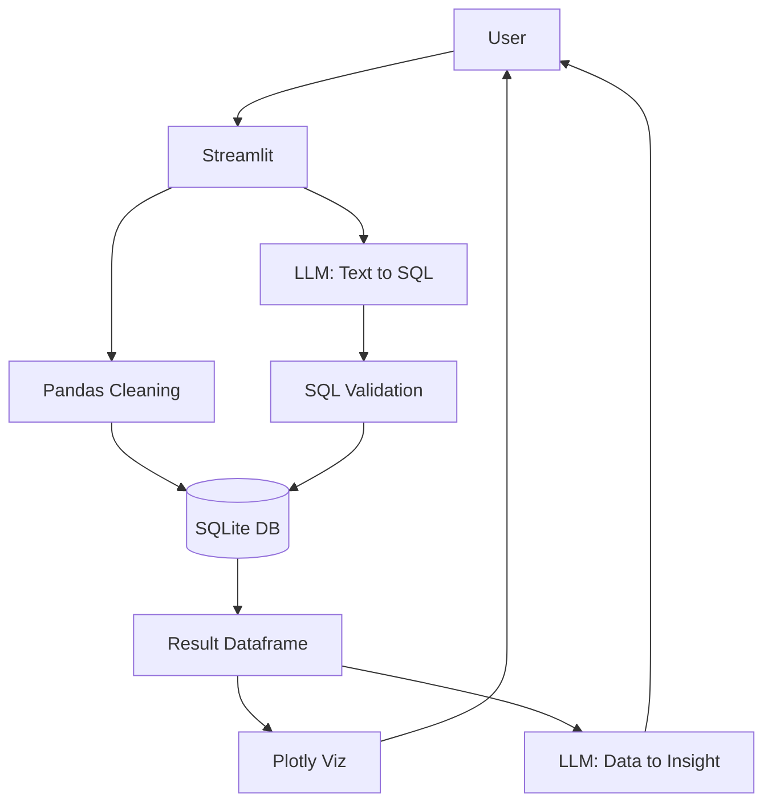

# AI-Powered Natural Language Data Analytics Assistant

## Overview
The **AI-Powered Natural Language Data Analytics Assistant** is a comprehensive, interactive web application that empowers users to analyze complex datasets simply by asking questions in plain English. No SQL or programming knowledge is required.

## Problem Statement
Business analysts, students, and managers often struggle to quickly extract insights from tabular data (CSV/Excel) because querying requires SQL or Python Pandas proficiency. This creates a bottleneck in decision-making and data exploration.

## Proposed Solution
An AI-driven dashboard that ingests datasets, cleans them, stores them in a lightweight local SQLite database, and uses a Large Language Model (LLM) to translate user questions into safe, read-only SQL queries. It automatically executes these queries, renders interactive Plotly visualizations, and provides natural language insights.

## Features
- **File Upload:** Support for CSV and Excel files.
- **Auto Data Cleaning:** Missing value imputation, duplicate removal, and data type detection.
- **Natural Language Querying:** Ask questions like *"Which product generated the highest revenue?"* and get instant answers.
- **Secure SQL Execution:** Stringent SQL validation ensuring only read-only `SELECT` statements are executed.
- **Auto Visualization:** Dynamic Plotly charts generated based on query results (Bar, Line, Scatter, Pie).
- **AI Insights:** Automated, easy-to-understand explanations of the returned data.
- **Machine Learning Prediction:** Optional basic Linear Regression model training on uploaded data.
- **Report Generation:** Downloadable history of analysis sessions.

## Technologies Used
- **Language:** Python 3.11+
- **Frontend:** Streamlit
- **Data Processing:** Pandas, NumPy
- **Database:** SQLite3
- **AI / LLM:** OpenAI API (configurable for other providers)
- **Visualization:** Plotly
- **Machine Learning:** Scikit-learn

## System Architecture


## Project Structure
```
AI_Data_Analytics_Assistant/
├── app.py
├── requirements.txt
├── .env.example
├── .gitignore
├── README.md
├── data/
│   └── sales_data.csv
├── modules/
│   ├── __init__.py
│   ├── data_cleaning.py
│   ├── database.py
│   ├── llm.py
│   ├── sql_generator.py
│   ├── visualization.py
│   ├── insights.py
│   └── prediction.py
└── tests/
    ├── __init__.py
    ├── test_data_cleaning.py
    ├── test_database.py
    └── test_sql_validation.py
```

## Installation & Setup

1. **Clone the repository:**
   ```bash
   git clone https://github.com/saikumarsingarapu41-glitch/AI_Data_Analytics_Assistant.git
   cd AI_Data_Analytics_Assistant
   ```

2. **Create and activate a virtual environment:**
   ```bash
   python -m venv venv
   # On Windows:
   venv\Scripts\activate
   # On Mac/Linux:
   source venv/bin/activate
   ```

3. **Install dependencies:**
   ```bash
   pip install -r requirements.txt
   ```

4. **Environment Setup:**
   - Copy `.env.example` to a new file named `.env`.
   - Add your OpenAI API key to the `.env` file:
     ```env
     LLM_API_KEY=your_actual_api_key_here
     LLM_MODEL=gpt-4o-mini
     ```

## Running the Application
```bash
streamlit run app.py
```
Open `http://localhost:8501` in your browser.

## Example Questions
Using the provided `sales_data.csv`, try asking:
- *Which product generated the highest revenue?*
- *What is the total profit by region?*
- *Which category has the highest sales?*
- *What are the top 5 customers?*

## Security
- **No API Keys in Code:** Managed strictly through `.env`.
- **SQL Sanitization:** The `sql_generator.py` validates tokens, rejects multiple queries, and strictly blocks keywords like `DROP`, `DELETE`, `UPDATE`, `INSERT`, etc.
- **Read-Only:** LLM-generated operations cannot mutate the dataset.

## Future Enhancements
- Support for multiple tables and auto-joins.
- Export visual charts to PDF.
- Integration with local open-source LLMs (e.g., LLaMA 3 via Ollama) for fully offline processing.
- Advanced predictive modeling options (Random Forest, XGBoost).
