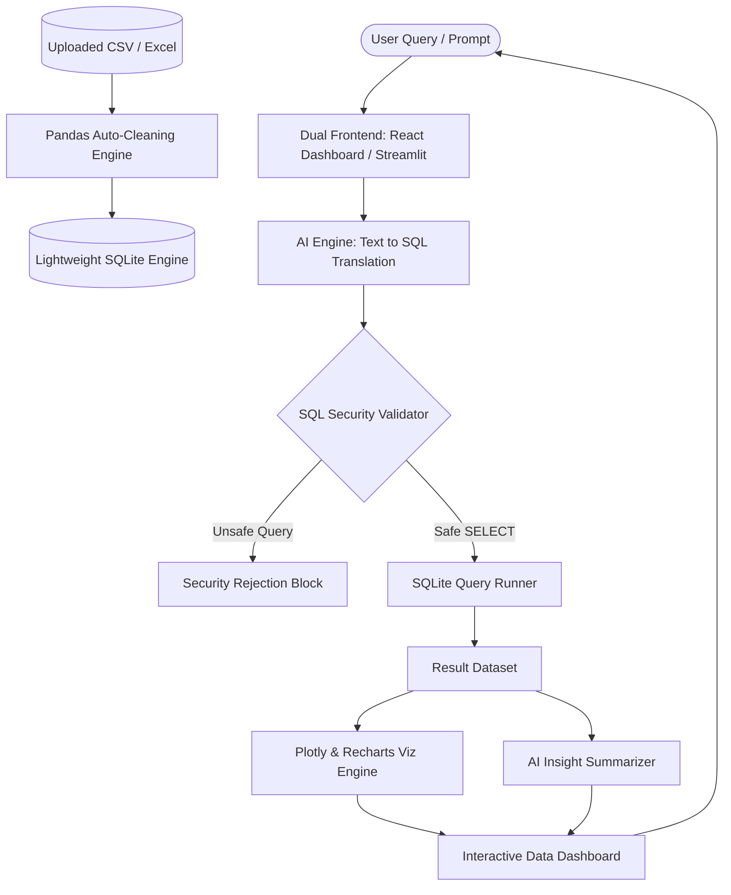

<div align="center">

# 📊 AI-Powered Data Analytics Assistant

**Transform Natural Language into Actionable Business Intelligence & Visual Analytics**

[](https://www.python.org/)
[](https://reactjs.org/)
[](https://fastapi.tiangolo.com/)
[](https://streamlit.io/)
[](https://plotly.com/)
[](LICENSE)

*Analyze complex tabular datasets (CSV / Excel) simply by asking questions in plain English — no SQL or Python programming required.*

[Key Features](#-key-features) • [System Architecture](#-system-architecture) • [Quick Start](#-quick-start) • [Dual Interface](#-dual-interface-options) • [API Reference](#-api-endpoints)

---

</div>

## 💡 Overview

The **AI-Powered Data Analytics Assistant** bridges the gap between raw data and decision-making. Business analysts, students, researchers, and executives often face bottlenecks waiting for custom SQL queries or Python scripts. 

With this assistant, you upload any CSV or Excel file, ask questions naturally (e.g., *"What were our top 5 selling products last quarter?"*), and receive:
1. **Accurate SQL execution** on an in-memory or SQLite database.
2. **Interactive charts** generated automatically using Plotly and Recharts.
3. **Automated AI insights** providing executive summaries and takeaways.
4. **Predictive machine learning** with instant regression and trend models.

---

## ✨ Key Features

| Feature | Description |
| :--- | :--- |
| 🗣️ **Plain-English Querying** | Natural Language to SQL translation powered by modern LLMs (Google Gemini & OpenAI). |
| 🛡️ **Safe & Secure SQL** | Read-only verification engine that rejects mutations (`DROP`, `DELETE`, `UPDATE`, `INSERT`) and multi-statement injection attacks. |
| 🧹 **Automated Data Cleaning** | Automatic missing-value imputation, duplicate removal, type inference, and column standardization. |
| 📈 **Dynamic Visualizations** | Smart chart selector automatically picks the best chart type (Bar, Line, Scatter, Area, Pie) based on query semantics. |
| 🔮 **Predictive Analytics** | Built-in machine learning models (Linear Regression, Scikit-Learn) for quick trend forecasting. |
| ⚡ **Dual Dashboard Experience** | Choose between a lightweight **Streamlit UI** or a high-performance **FastAPI + React (Vite)** full-stack dashboard. |
| 📄 **Executive Reports** | Downloadable query logs and analysis summaries for reporting and team sharing. |

---

## 🏗️ System Architecture



---

## 📁 Repository Structure

```plaintext
AI-powered-assistant/
├── app.py                     # Streamlit application dashboard
├── api.py                     # FastAPI REST API backend
├── demo_script.py             # CLI demonstration and test script
├── requirements.txt           # Python library dependencies
├── .env.example               # Template for API keys
├── .gitignore                 # Files excluded from git tracking
├── README.md                  # Project documentation
├── start.bat / start.ps1      # 1-click startup automation scripts
├── run_app.bat                # Shortcut to launch Streamlit app
├── run_api.bat                # Shortcut to launch FastAPI backend
├── run_react_frontend.bat     # Shortcut to launch React Vite app
├── data/                      # Sample datasets for instant testing
│   ├── sales_data.csv         # Retail sales sample dataset
│   └── census_data.csv        # Demographic census dataset
├── modules/                   # Core backend processing modules
│   ├── data_cleaning.py       # Data sanitization & type inference
│   ├── database.py            # SQLite schema management & execution
│   ├── llm.py                 # LLM provider interface (Gemini / OpenAI)
│   ├── sql_generator.py       # Prompt engineering & Text-to-SQL logic
│   ├── visualization.py       # Chart generation utilities
│   ├── insights.py            # Automatic statistical commentary
│   └── prediction.py          # Machine learning regression models
├── frontend/                  # React modern dashboard
│   ├── package.json           # Frontend dependencies
│   ├── vite.config.js         # Vite bundling configuration
│   └── src/                   # React components & visual design system
└── tests/                     # Automated unit and integration test suite
    ├── test_api.py            # FastAPI endpoint tests
    ├── test_data_cleaning.py  # Cleaning pipeline tests
    ├── test_database.py       # SQLite execution tests
    ├── test_insights.py       # Insight generation tests
    ├── test_prediction.py     # ML prediction tests
    ├── test_sql_generator.py  # Prompt & query generation tests
    └── test_sql_validation.py # SQL security guard tests
```

---

## 🚀 Quick Start

### 1. Clone the Repository
```bash
git clone https://github.com/saikumarsingarapu41-glitch/AI-powered-assistant.git
cd AI-powered-assistant
```

### 2. Set Up Python Virtual Environment
```bash
python -m venv venv

# Windows:
venv\Scripts\activate

# macOS / Linux:
source venv/bin/activate
```

### 3. Install Dependencies
```bash
pip install -r requirements.txt
```

### 4. Configure Environment Variables
Copy `.env.example` to `.env` and insert your API key:
```env
GEMINI_API_KEY=your_gemini_api_key_here
# Or if using OpenAI:
LLM_API_KEY=your_openai_api_key_here
LLM_MODEL=gpt-4o-mini
```

---

## 🖥️ Dual Interface Options

### Option 1: Streamlit Dashboard (Zero Frontend Config)
Fast, interactive dashboard ideal for quick data exploration:
```bash
streamlit run app.py
```
*Or double click:* `run_app.bat`  
Default URL: `http://localhost:8501`

### Option 2: Full-Stack React + FastAPI Dashboard
A sleek, modern production-grade experience:
1. **Start the FastAPI backend:**
   ```bash
   python api.py
   ```
2. **Start the React frontend:**
   ```bash
   cd frontend
   npm install
   npm run dev
   ```
*Or simply run the all-in-one script:* `start.bat` / `start.ps1`  
Default URLs:
- React Frontend: `http://localhost:5173`
- FastAPI Swagger Docs: `http://localhost:8000/docs`

---

## 💬 Example Natural Language Queries

Try these sample queries using the included `data/sales_data.csv`:
- *"Which product generated the highest overall revenue?"*
- *"Show total profit breakdown grouped by region."*
- *"What is the monthly sales trend across categories?"*
- *"List the top 5 customers ordered by purchase volume."*
- *"Are there correlations between discounts and profit margins?"*

---

## 🔌 API Endpoints

| Method | Endpoint | Description |
| :--- | :--- | :--- |
| `GET` | `/health` | Healthcheck and server status |
| `POST` | `/api/upload` | Upload CSV/Excel and initialize SQLite table |
| `POST` | `/api/query` | Translate natural language to SQL and execute |
| `POST` | `/api/predict` | Train a predictive regression model |
| `GET` | `/api/history` | Retrieve query and insight history |

---

## 🔒 Security & Data Privacy

- **Read-Only Enforced**: Only queries starting with `SELECT` pass validation.
- **SQL Injection Prevention**: Multiple query separation (`;`), comments (`--`), and DDL/DML statements (`DROP`, `ALTER`, `DELETE`, `UPDATE`) are strictly blocked.
- **Local Storage**: Data stays on your local SQLite instance — only table schemas and analytical prompts are processed by the LLM.
- **Environment Isolation**: Secret keys are never hardcoded and are filtered by `.gitignore`.

---

## 🧪 Testing

Run the automated test suite with `pytest`:
```bash
pytest -v
```

---

## 👤 Author

**Sai Kumar Singarapu**  
- GitHub: [@saikumarsingarapu41-glitch](https://github.com/saikumarsingarapu41-glitch)
- Project: [AI-powered-assistant](https://github.com/saikumarsingarapu41-glitch/AI-powered-assistant)

---

## 📄 License

This project is licensed under the MIT License — see the [LICENSE](LICENSE) file for details.
