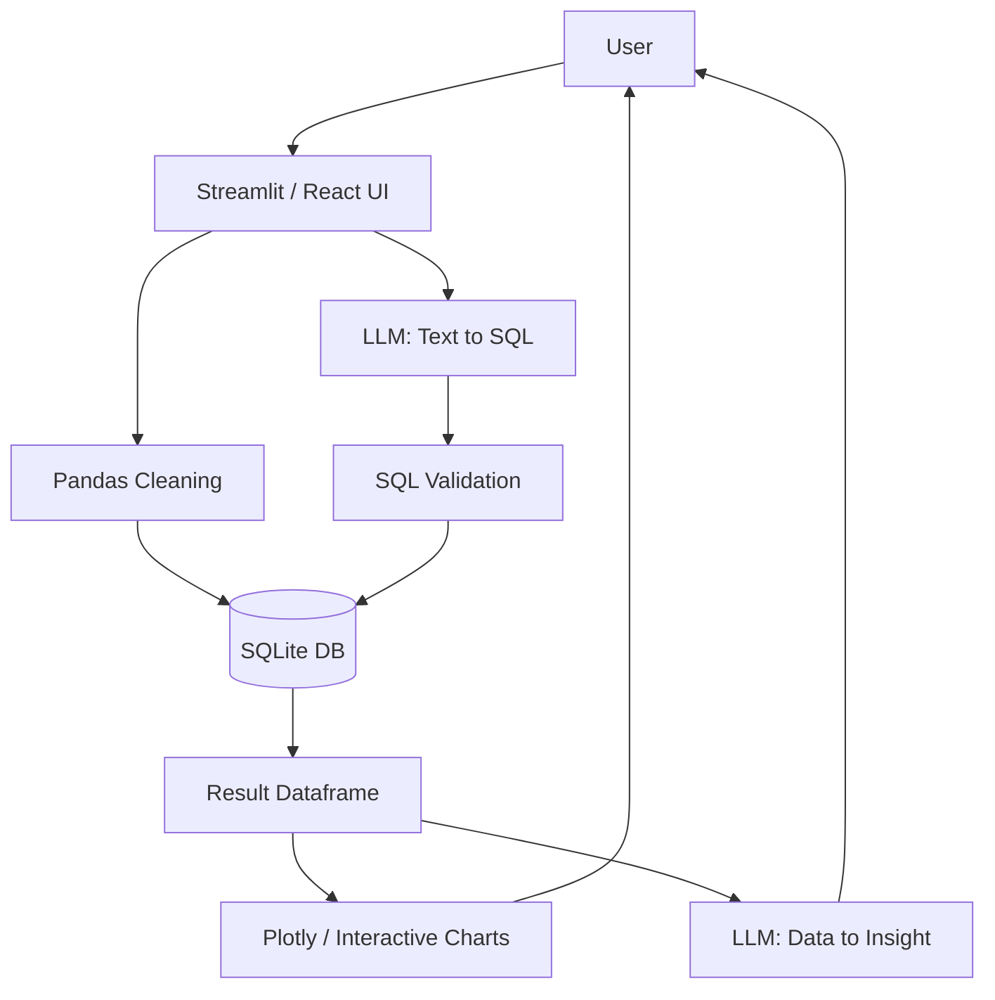

# AI-Powered Natural Language Data Analytics Assistant

## Overview
The **AI-Powered Natural Language Data Analytics Assistant** is a comprehensive, interactive application that empowers users to analyze complex datasets simply by asking questions in plain English. No SQL or programming knowledge is required.

## Problem Statement
Business analysts, students, and managers often struggle to quickly extract insights from tabular data (CSV/Excel) because querying requires SQL or Python Pandas proficiency. This creates a bottleneck in decision-making and data exploration.

## Proposed Solution
An AI-driven dashboard that ingests datasets, cleans them, stores them in a lightweight local SQLite database, and uses a Large Language Model (LLM) to translate user questions into safe, read-only SQL queries. It automatically executes these queries, renders interactive Plotly visualizations, and provides natural language insights.

## Features
- **File Upload:** Support for CSV and Excel files.
- **Auto Data Cleaning:** Missing value imputation, duplicate removal, and data type detection.
- **Natural Language Querying:** Ask questions like *"Which product generated the highest revenue?"* and get instant answers.
- **Secure SQL Execution:** Stringent SQL validation ensuring only read-only `SELECT` statements are executed.
- **Auto Visualization:** Dynamic Plotly charts generated based on query results (Bar, Line, Scatter, Pie).
- **AI Insights:** Automated, easy-to-understand explanations of the returned data.
- **Machine Learning Prediction:** Optional basic Linear Regression model training on uploaded data.
- **Report Generation:** Downloadable history of analysis sessions.
- **Dual Interface:** Choose between a Streamlit app or a modern FastAPI + React dashboard.

## Technologies Used
- **Backend:** Python 3.11+, FastAPI / Streamlit
- **Frontend:** Streamlit & React (Vite, Tailwind/Modern CSS)
- **Data Processing:** Pandas, NumPy
- **Database:** SQLite3
- **AI / LLM:** Google Gemini / OpenAI API
- **Visualization:** Plotly, Recharts
- **Machine Learning:** Scikit-learn

## System Architecture


## Project Structure
```
.
├── app.py                     # Streamlit application
├── api.py                     # FastAPI REST API backend
├── requirements.txt           # Python dependencies
├── .env.example               # Environment variables template
├── .gitignore                 # Git ignore rules
├── README.md                  # Project documentation
├── start.bat / start.ps1      # Quick startup scripts
├── run_app.bat                # Launch Streamlit app
├── run_api.bat                # Launch FastAPI server
├── run_react_frontend.bat     # Launch Vite React frontend
├── data/
│   ├── sales_data.csv
│   └── census_data.csv
├── modules/
│   ├── __init__.py
│   ├── data_cleaning.py
│   ├── database.py
│   ├── llm.py
│   ├── sql_generator.py
│   ├── visualization.py
│   ├── insights.py
│   └── prediction.py
├── frontend/                  # React + Vite dashboard
└── tests/
    ├── __init__.py
    ├── test_api.py
    ├── test_data_cleaning.py
    ├── test_database.py
    ├── test_insights.py
    ├── test_prediction.py
    ├── test_sql_generator.py
    └── test_sql_validation.py
```

## Installation & Setup

1. **Clone the repository:**
   ```bash
   git clone https://github.com/saikumarsingarapu41-glitch/AI_Data_Analytics_Assistant.git
   cd AI_Data_Analytics_Assistant
   ```

2. **Create and activate a virtual environment:**
   ```bash
   python -m venv venv
   # On Windows:
   venv\Scripts\activate
   # On Mac/Linux:
   source venv/bin/activate
   ```

3. **Install dependencies:**
   ```bash
   pip install -r requirements.txt
   ```

4. **Environment Setup:**
   - Copy `.env.example` to a new file named `.env`.
   - Configure your Gemini / OpenAI API key in `.env`:
     ```env
     GEMINI_API_KEY=your_actual_api_key_here
     ```

## Running the Application

### Option A: Streamlit UI
```bash
streamlit run app.py
```
Or run:
```bat
run_app.bat
```
Open `http://localhost:8501` in your browser.

### Option B: FastAPI Backend + React Frontend
1. Start FastAPI:
   ```bash
   python api.py
   ```
2. In another terminal, start the React frontend:
   ```bash
   cd frontend
   npm install
   npm run dev
   ```
Or simply double-click `start.bat`.

## Security
- **No Secrets Committed:** Kept safe via `.gitignore` and `.env`.
- **SQL Sanitization:** The `sql_generator.py` validates tokens, rejects multiple queries, and strictly blocks keywords like `DROP`, `DELETE`, `UPDATE`, `INSERT`, etc.
- **Read-Only:** LLM-generated operations cannot mutate the dataset.
